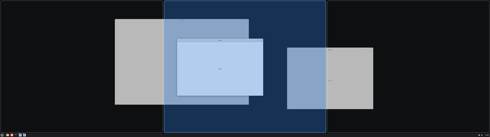

# Snap Zones for Cinnamon

A Cinnamon extension for wide monitors. Hold **Shift** while dragging a window
and the screen splits into columns; drop the window and it fills the highlighted
one. Keep it over a column for two seconds and that column divides into a top
and a bottom half.



## The human written part (All other passages are written by LLM)

I have my Dell U49 ultra-wide monitor for several years now and the one thing always
annoyed me during my daily Linux usage was the lack if Dell Display Manager's
window snap feature, allowing me to split the desktop into multiple section and
automatically snow windows into them.
Yesterday I asked Fable 5.2 to create something for me and after being done doing so
also mentioned that there is already such a project called [FancyTiles](https://github.com/QuantumWarp/fancytiles).
Probably better coded and more feature, but didn't bother since LLM was done already.
The thing works for me perfectly and does all I wanted.
Perhaps anyone has usage for it as well. And if not, another piece of vibe-coded AI barf.
¯\_(ツ)_/¯


## This is vibe-coded

Every line of code here was written by an AI model (Claude) from plain-language
requests in a chat. The maintainer described what they wanted and tried the
result on their own desktop; they did not write the code.

What that means for you:

- It has been used on one setup only: Cinnamon 6.6 (Muffin 6.6) on X11 with a
  single 5120×1440 monitor. Wayland and multi-monitor setups are untested.
- During development it passed 106 automated drag checks in a nested Cinnamon
  session. Those test scripts are not part of this repository.
- Read the code before you trust it. It is one file:
  [`snap-zones@local/extension.js`](snap-zones@local/extension.js).

## Install

```bash
./install.sh
```

This copies the extension to `~/.local/share/cinnamon/extensions/` and enables
it. No root and no restart needed. `./install.sh --remove` takes it out again.

## Use

- Start dragging a window, then hold Shift. Three columns appear and the one
  under the pointer lights up. Release the mouse button to drop the window in.
- Keep the window over the same column for two seconds and it divides into a
  top and a bottom half. Dragging on into another column undoes that.
- Let go of Shift before the mouse button to carry on with an ordinary drag.


## Settings

System Settings → Extensions → Snap Zones → gear icon.

| Setting | Default |
| --- | --- |
| Column widths, as ratios | `1:1:1` |
| Gap around snapped windows | `0` px |
| Hold time before a column splits (`0` = never) | `2` s |

## Good to know

- Without Shift, dragging is unchanged, and Cinnamon's own edge tiling keeps
  working.
- While the extension is enabled it replaces what Cinnamon normally does on
  Shift+drag, which is snapping the window to nearby edges.
- Terminals resize in whole character cells, so they come out a few pixels
  smaller than the zone.
- The trigger key is fixed to Shift.
